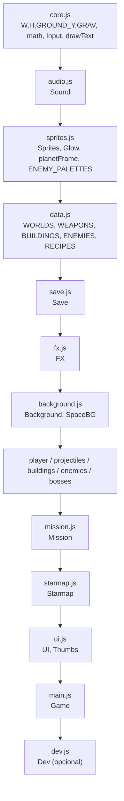
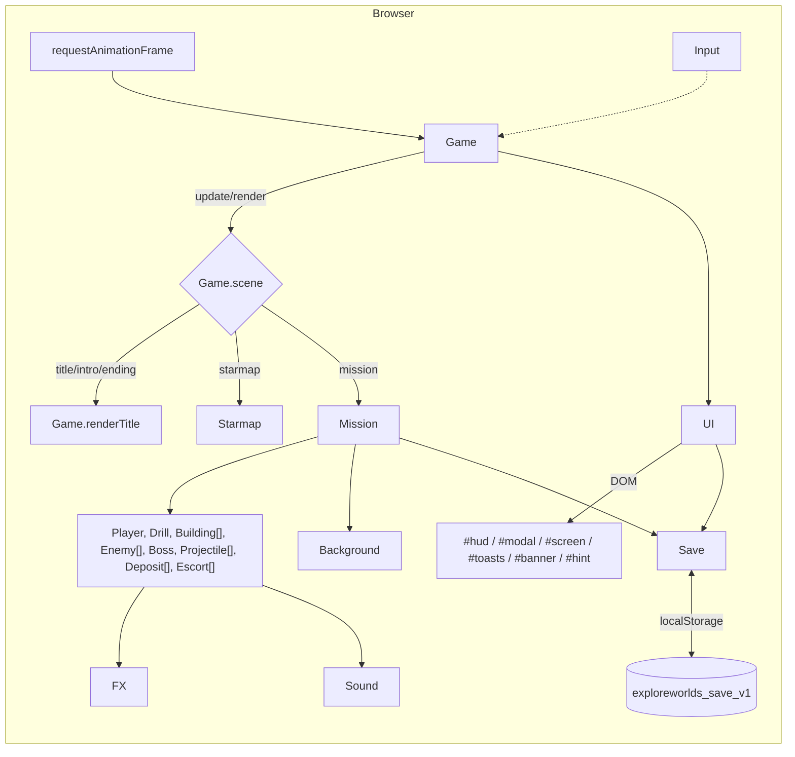
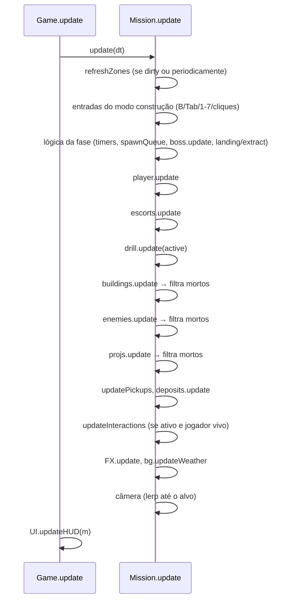
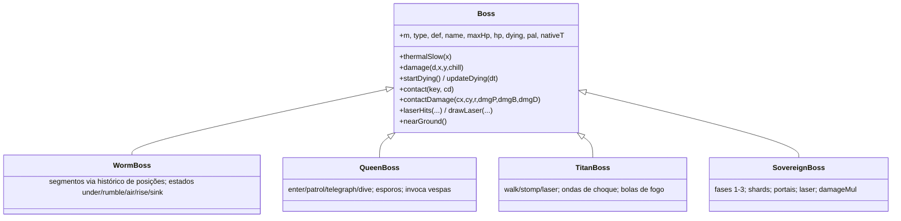
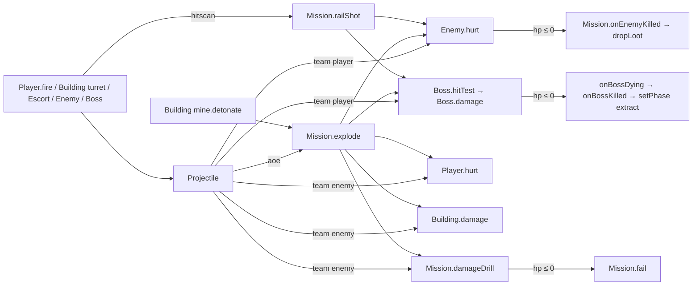

# Explore Worlds: Documento Técnico de Arquitetura

> Descreve a arquitetura do código como ela está hoje. Para regras de jogo e balanceamento, veja o [GDD.md](GDD.md).

---

## 1. Resumo

| Aspecto | Escolha |
|---|---|
| Linguagem | JavaScript ES2020+ "vanilla", com `'use strict'` em cada arquivo |
| Módulos | **Nenhum**: scripts clássicos carregados em ordem fixa no `index.html`, compartilhando o escopo global |
| Build / dependências | Nenhuma. Só as Google Fonts (Press Start 2P, VT323) por CDN |
| Renderização do jogo | Canvas 2D de **480×270**, `imageSmoothingEnabled = false`, escalado via CSS |
| Interface | DOM sobreposto ao canvas (`#ui`), estilizado em [`css/style.css`](../css/style.css) |
| Áudio | WebAudio 100% sintetizado (sem arquivos de som) |
| Arte | 100% procedural/código (sem imagens) |
| Persistência | `localStorage`, JSON |
| Execução | Abrir `index.html`, ou [`start.bat`](../start.bat) (sobe `python -m http.server` / `py` / `npx http-server` na porta 8137) |
| Tamanho | ~4.900 linhas de JS em 18 arquivos |

---

## 2. Estrutura de arquivos

```
worlds/
├── index.html          # canvas + #ui + ordem dos scripts
├── start.bat           # servidor local opcional (porta 8137)
├── css/style.css       # toda a UI DOM (título, mapa, modais, HUD)
├── docs/               # GDD e este documento
└── js/
    ├── core.js         # constantes, matemática, RNG, cores, Input, fonte bitmap
    ├── audio.js        # Sound: SFX sintetizados + música generativa
    ├── sprites.js      # Sprites, Glow, sprites de jogador/inimigos, ícones, planetas
    ├── data.js         # RES, BIOMES, WORLDS, WEAPONS, BUILDINGS, ENEMIES, BOSSES, RECIPES
    ├── save.js         # Save: estado persistente
    ├── fx.js           # FX: partículas, textos, anéis, feixes, tremor, flash
    ├── background.js   # Background (cenário da missão) e SpaceBG (fundo espacial)
    ├── player.js       # Player e Escort
    ├── projectiles.js  # Projectile
    ├── buildings.js    # Building, Drill, Deposit
    ├── enemies.js      # Enemy
    ├── bosses.js       # Boss + Worm/Queen/Titan/Sovereign + makeBoss
    ├── mission.js      # Mission: máquina de estados da partida
    ├── starmap.js      # Starmap: navegação entre mundos
    ├── ui.js           # UI (DOM) + Thumbs (miniaturas)
    ├── main.js         # Game: loop principal e cenas
    └── dev.js          # Dev: ferramentas de teste (só com ?dev)
```

### 2.1 Ordem de carregamento e dependências

Como não há módulos, **a ordem dos `<script>` é o grafo de dependências**. Cada arquivo só usa, no momento em que é carregado, símbolos definidos por arquivos anteriores. Referências a símbolos posteriores só podem acontecer dentro de funções executadas depois do `window.load`.



> [!NOTE]
> `data.js` depende de `Save` (em `worldReachable` e no `req` da Chave do Núcleo), mas só dentro de funções, então a ordem `data` → `save` funciona.

---

## 3. Visão de alto nível



Camadas:

1. **Plataforma** ([`core.js`](../js/core.js), [`audio.js`](../js/audio.js), [`sprites.js`](../js/sprites.js), [`fx.js`](../js/fx.js)): utilitários sem regra de jogo.
2. **Dados** ([`data.js`](../js/data.js)): tabelas declarativas de conteúdo e balanceamento.
3. **Estado persistente** ([`save.js`](../js/save.js)).
4. **Simulação** (entidades + [`mission.js`](../js/mission.js)): regras de jogo.
5. **Apresentação/fluxo** ([`starmap.js`](../js/starmap.js), [`ui.js`](../js/ui.js), [`main.js`](../js/main.js)).

---

## 4. Loop principal e cenas, em [`main.js`](../js/main.js)

### 4.1 `Game`

Singleton com `scene`, `mission`, `paused` e `t`.

```js
loop(ts) {
  const dt = Math.min(0.05, (ts - this.last) / 1000 || 0.016); // passo variável com teto de 50ms
  this.update(dt); this.render();                              // envoltos em try/catch
  Input.endFrame();                                            // limpa os "pressed" do frame
  requestAnimationFrame(...);
}
```

- **Passo de tempo variável** com teto de 50 ms (abaixo de 20 FPS o jogo desacelera em vez de "pular").
- `try/catch` evita que uma exceção mate o loop (o erro vai para o console).
- **Cenas**: `title`, `intro`, `starmap`, `mission`, `ending`. As transições passam por métodos (`toTitle`, `intro`, `toStarmap`, `startMission`, `missionEnded`, `ending`), quase sempre via `UI.fade(cb)`.
- **Pausa**: Esc/P na missão abre `UI.showPause`. `Game.paused` congela `Mission.update`, mas o HUD continua atualizando. Com a missão encerrada (`m.ended`), só FX e clima continuam rodando atrás do modal de resultados.
- No mapa estelar, `Starmap.update` não roda com modal aberto (Fabricador, Menu etc.).
- `M` alterna o som globalmente, em qualquer cena.

### 4.2 Escala da tela

`Game.resize()` calcula `s = min(vw/480, vh/270)`; com s ≥ 2, arredonda para múltiplos de 0.5 (pixels nítidos). O tamanho é aplicado ao `#stage` e exposto como a variável CSS `--u` (1 "pixel de jogo" em px), que a UI usa para dimensionar tudo de forma consistente com o canvas.

---

## 5. Plataforma

### 5.1 [`core.js`](../js/core.js)

| Grupo | Conteúdo |
|---|---|
| Constantes | `W=480`, `H=270`, `GROUND_Y=214` (linha do chão), `TILE=16`, `GRAV=620` px/s², `TAU` |
| Matemática | `clamp`, `lerp`, `rand`, `randi`, `choose`, `sign`, `dist`/`dist2`, `approach`, `angleLerp`, `easeOutCubic`, `easeInOut` |
| Colisão | `rectsOverlap`, `pointInRect`, `circleRect` |
| RNG determinístico | `seededRng(seed)` (xorshift32), `hashStr` (FNV-1a) |
| Cores | `hexToRgb`, `rgba`, `mixHex`, `shade` |
| Canvas | `makeCanvas(w,h)` (offscreen com smoothing desligado) |
| **Input** | Estado por `KeyboardEvent.code`: `down`, `pressed` (borda de subida no frame), `released`; mouse em coordenadas **internas** (0–480 × 0–270), `left/right`, `leftPressed/rightPressed`, `wheel`. `endFrame()` zera as bordas. Bloqueia o scroll de Espaço/Tab/setas, o menu de contexto e a roda no canvas; limpa tudo no `blur` |
| **Gamepad & DualSense** | Suporte unificado à W3C Gamepad API com detecção automática do **Sony DualSense (PS5)** via ID (`isPlayStation`). Gerencia `gpDown`, `gpPressed`, `gpReleased`, deadzone de 18% para eixos analógicos (`applyDeadzone`), mira Twin-Stick 360° em tempo real, suporte háptico `dual-rumble` (`Input.rumble`), cursor virtual retrô para menus (`Input.drawVirtualCursor`), emulação de cliques DOM (`Input.clickElementAtMouse`) e glifos dinâmicos (`Input.btn`) |
| Texto bitmap | `FONT` 3×5, glifos em cache por cor (`_glyphCache`), `normText` (remove acentos, caixa alta), `drawText(ctx, text, x, y, color, scale, align, shadow)`, `textWidth` |

### 5.2 [`audio.js`](../js/audio.js): `Sound`

- **Desbloqueio preguiçoso**: o `AudioContext` só é criado em `Sound.unlock()`, chamado no primeiro clique/tecla (política de autoplay). Uma música pedida antes disso fica em `mus.wanted` e começa no desbloqueio.
- **Grafo**: `sfx (0.55)` e `music (0.32)` → `DynamicsCompressor` → `master (0.7)` → destino. O mute faz rampa no `master`.
- **Primitivas**: `tone({type,f,f2,dur,vol,attack,delay,dest,curve})` (oscilador com envelope exponencial e glide opcional) e `noise({...})` (buffer de ruído branco de 1s + biquad).
- `play(name, {vol, gap})`: `switch` com ~35 efeitos nomeados; o **anti-spam** ignora repetições do mesmo som em menos de `gap` ms (35 por padrão).
- **Música generativa**: `startMusic(mode, biome)` cria um *pad* (3 vozes × 2 osciladores serra desafinados → lowpass modulado por LFO) e um **agendador look-ahead** (`setInterval` de 60 ms que agenda notas até 200 ms à frente em `ctx.currentTime`). `SCALES`/`ROOTS` por bioma; o modo `combat` tem passo de 1/8 com bumbo/chimbal/baixo; `setIntensity(0..1)` aumenta a densidade.

### 5.3 [`sprites.js`](../js/sprites.js)

- `Sprites.fromRows(rows, pal)`: converte matrizes de caracteres (cada char é um índice de paleta) em canvas. `Sprites.get(key, build)` faz cache por chave; `Sprites.flash(img)` gera a versão branca para o efeito de acerto.
- `drawSprite(ctx, img, x, y, flip, flash)`.
- `Glow`: gradientes radiais pré-renderizados em cache por (cor, raio), desenhados com `lighter`. É o "bloom" barato usado no jogo inteiro.
- `playerSprite(frame)` (idle/run1/run2/jump), `ENEMY_PALETTES[biome]` (`o` contorno, `a/b/c` tons, `e` olhos/brilho), `ENEMY_ROWS` e `enemySprite(name, biome)`, que fazem o **reskin de inimigos por bioma** via troca de paleta.
- Recursos: `resIcon(res)` (canvas) e `resIconUrl(res)` (dataURL para o DOM), mais `canvasUrl(canvas, scale)`.
- Planetas: `makeNoise2D(seed)`, `PLANET_COLORS`, `renderPlanet(...)` (esfera com ruído e iluminação por pixel) e `planetFrame(r, biome, seed, t, frames)`, que quantiza a rotação em N quadros guardados num `Map`.

### 5.4 [`fx.js`](../js/fx.js): `FX`

Sistema global de efeitos, **independente da simulação** (não afeta gameplay):

| Lista | Uso |
|---|---|
| `parts` (máx. 1600, descarta as mais antigas) | Partículas `px`, `spark`, `smoke`, `flashball`; opções de gravidade, arrasto, quique e brilho |
| `texts` (máx. 60) | Números de dano e textos de coleta |
| `rings` | Ondas de choque de explosões |
| `beams` | Feixes (railgun, raio de reparo) |
| `shake`, `flash` | Tremor e flash de tela, com decaimento linear |

Helpers: `add`, `burst`, `explosion` (combina flash, anel, faíscas, fumaça, detritos e tremor), `text`, `beam`, `addShake`, `screenFlash`. `update` compacta o array de partículas no lugar (sem alocação). `FX.reset()` é chamado a cada troca de cena/missão.

### 5.5 [`background.js`](../js/background.js)

- `Background(biome, levelW, seed)` **pré-renderiza** em canvases offscreen: céu (faixas + dithering + estrelas + nebulosa), **3 camadas de montanhas** e o **terreno inteiro** (1700×270, com props, estratos e superfície). Em tempo de jogo só faz `drawImage` com parallax (`factors = [0.12, 0.28, 0.5]`).
- Astro celeste do bioma (`drawCelestial`) e **clima** (90 partículas em espaço de tela, recicladas ao sair dela).
- `SpaceBG`: fundo estrelado do título e do mapa estelar.

---

## 6. Dados, em [`data.js`](../js/data.js)

Arquivo **puramente declarativo** e o ponto único de balanceamento:

| Tabela | Chave | Campos relevantes |
|---|---|---|
| `RES`, `RES_ORDER` | id do recurso | `name`, `color`, `desc` |
| `BIOMES` | id do bioma | cores de céu/montanhas/chão, `weather`, `fog`, `light`, `celestial`, `deco` |
| `WORLDS`, `WORLD_BY_ID` | `id` | `biome`, `tier`, `temp`, `gravity`, `res`, `res2?`, `waves`, `boss`, `pos` (no mapa), `r`, `final?`, `desc` |
| `WEAPONS`, `WEAPON_ORDER` | id da arma | `rate`, `dmg`, `speed`, `spread`, `heat`, `count`, `life`, `size`, `color`, `sfx`, `knock`, flags `chill`/`pierce`/`aoe`/`rocket`/`hitscan` |
| `BUILDINGS`, `BUILD_ORDER` | tipo | `cost`, `hp`, `w`, `h`, `solid`, `range`/`rate`/`dmg`/`radius`/`delta` |
| `ENEMIES` | tipo | `hp`, `speed`, `dmg`, `atkRate`, `w`, `h`, `scrap`, `cost` (orçamento), `minWave`, flags `ranged`/`air`/`bomber`/`heavy`, `bldMul`, `sprite[]` |
| `BOSSES` | tipo | `name`, `hp` |
| `RECIPES`, `RECIPE_CATS` | `id` | `cat`, `max?`, `cost[]` (um por nível), `weapon?`/`blueprint?`/`item?`+`qty`, `req?()`+`reqText`, `icon`/`ico` |
| `ITEMS` | id | `name`, `key` |

Regras derivadas: `worldReachable(w)` e `worldLockReason(w)`.

**Convenção de receitas**: sem `max`, a receita é consumível e repetível (itens). Com `max`, é um upgrade com nível em `Save.data.upgrades[id]`, e `cost[min(nível, len−1)]` dá o custo do próximo nível. Os efeitos **não ficam na receita**: cada sistema lê `Save.lvl('id')` no construtor da entidade (ex.: `Player` lê `armor`, `jetpack`, `dmg`; `Building` lê `turret_mk`; `Drill` lê `drill_speed`, `cargo`).

> [!TIP]
> Para adicionar um upgrade: (1) crie a receita em `RECIPES`; (2) leia `Save.lvl('novo_id')` no construtor da entidade afetada. A UI do Fabricador já renderiza tudo automaticamente.

---

## 7. Persistência, em [`save.js`](../js/save.js)

```js
Save.data = {
  inv:        { sucata, ferro, bio, crio, piro, grav, vazio },
  items:      { grenade, medkit, repairkit },
  weapons:    ['blaster', ...],          // armas liberadas
  upgrades:   { [recipeId]: nível },     // inclui armas/projetos (nível 1)
  blueprints: ['wall','turret','mine',...],
  completed:  { [worldId]: vezes },
  location:   'home' | worldId,          // onde a nave está no mapa
  stats:      { missions, success, kills, bosses, playTime },
  tutorialDone, won, created,
}
```

- `load()` faz **merge raso com os defaults** (e merge explícito de `inv`, `items` e `stats`), o que torna o save tolerante a campos novos. JSON corrompido cai nos defaults.
- API: `exists`, `load`, `newGame`, `save`, `lvl(id)`, `has(cost)`, `spend(cost)`, `add(res, n)`.
- **Quando grava**: ao fabricar (`UI.craft`), ao **terminar a missão** (`Mission.finish`) e em `newGame`. Durante a missão, `Save.data` é alterado em memória (coleta, gasto em construções, uso de itens), mas **não é gravado**.

> [!WARNING]
> Por esse comportamento, recarregar a página no meio de uma missão desfaz tudo o que aconteceu nela. Hoje isso funciona como um "anti-exploit" implícito, mas não está documentado no código. `stats.playTime` nunca é incrementado.

---

## 8. Simulação da missão, em [`mission.js`](../js/mission.js)

### 8.1 Responsabilidades de `Mission`

`Mission` é o **mundo da partida** e o **mediador** entre as entidades. Cada entidade guarda uma referência `this.m` para a missão e chama seus serviços.

| Categoria | Membros |
|---|---|
| Estado | `world`, `biomeDef`, `width=1700`, `depleted`, `hpMul`/`dmgMul`/`bossHpMul` (por tier), `seed`, `phase`/`phaseT`, `wave`/`waves`, `spawnQueue`, `collected`, `stats`, `buildMode`/`buildSel`, `camX`, `tutorial`/`tutStep`, `ended`/`result` |
| Coleções | `player`, `drill`, `buildings[]`, `enemies[]`, `projs[]`, `pickups[]`, `deposits[]`, `escorts[]`, `boss` |
| Consultas de ambiente | `refreshZones()` (cache de `tempZones`/`gravZones`), `tempAt(x)`, `gravAt(x)`, `gravZoneAt(x)`, `mouseWorld()` |
| Serviços para entidades | `addProj`, `collect`, `dropLoot`, `nearestEnemy` (inclui `boss.targetPoint()`), `damageEnemy`, `damageDrill`, `explode` (dano em área com flags `hurtsEnemies/Player/Buildings`), `railShot` (hitscan por amostragem a cada 3 px), `useRepairKit`, `announce`, `toast` |
| Eventos | `onEnemyKilled`, `onBossDying`, `onBossKilled`, `fail`, `finish`, `abandon` |
| Fases | `setPhase(p)` (efeitos de entrada), `updateLanding`, `updateExtract`, `genWave(n)` |
| Construção | `unlocked`, `ghost()` (validação do posicionamento), `place`, `buildingAtMouse`, `sell` |
| Interação | `updateInteractions` (depósitos, torre de gravidade, reparo), `updatePickups` |
| Render | `render`, `drawPickups`, `drawShip`, `drawBuildGhost`, `drawOverlay` (vinhetas, indicadores, minimapa) |

### 8.2 Máquina de estados

`phase ∈ { landing, prep, wave, break, bossWarn, boss, extract, failed }`. A lista de fases "ativas" (`prep, wave, break, bossWarn, boss`) controla a mineração da broca, as interações e o modo construção. Diagrama no GDD §2.2.

### 8.3 Ordem de atualização por frame



A remoção de entidades é feita com **flag `dead` + `filter`** depois de cada grupo atualizar. Não há pool de objetos (exceto as partículas do FX, que são compactadas no lugar).

### 8.4 Ordem de desenho (camadas)

1. `bg.drawBack` (céu, astro, montanhas em parallax)
2. Zonas de efeito das construções (`drawZone`)
3. `bg.drawTerrain`
4. Depósitos → Broca → Tetos → demais construções
5. Verme Colossal (atrás das unidades, recortado no chão)
6. Inimigos terrestres (e voadores puxados ao chão)
7. Pickups → Jogador → Drones
8. Inimigos aéreos
9. Outros chefes → Nave → Projéteis → `FX.draw` → clima
10. Fantasma de construção → textos flutuantes → prompts
11. `drawOverlay` (sem tremor): vinhetas, flash, indicadores fora da tela, minimapa

O tremor de tela é aplicado com `ctx.translate` aleatório entre as camadas 1 e 10.

### 8.5 Geração procedural

- **Seed da missão**: `hashStr(world.id) + stats.missions × 7919`. A partir dela saem o cenário (`Background`) e os depósitos (`genDeposits` com `seededRng(seed + 3)`).
- Ondas, IA e partículas usam `Math.random()` (não determinístico).

---

## 9. Entidades

Não há ECS nem classe base comum: cada entidade é uma **classe com interface implícita** ("duck typing"):

| Método/prop | Player | Enemy | Boss | Building | Drill | Projectile | Deposit | Escort |
|---|---|---|---|---|---|---|---|---|
| `update(dt)` | ✔ | ✔ | ✔ | ✔ | ✔ (`dt, mining`) | ✔ (`dt, m`) | ✔ | ✔ |
| `draw(ctx, camX)` | ✔ | ✔ | ✔ | ✔ | ✔ | ✔ | ✔ | ✔ |
| `rect()` | ✔ | ✔ | Queen/Titan | ✔ | ✔ | — | — | — |
| `dead` | ✔ | ✔ | ✔ | ✔ | — | ✔ | `done` | — |
| Receber dano | `hurt(d, srcX, kind)` | `hurt(d, o)` | `damage(d, x, y, chill)` | `damage(d)` | via `m.damageDrill` | — | — | — |
| Hitbox especial | — | — | `hitTest(x,y,r)`, `targetPoint()`, `nearGround()` | `fieldRect()` (teto) | — | — | — | — |

### 9.1 [`player.js`](../js/player.js)

- **`Player`**: física própria (aceleração, pulo, jetpack com "arm" no segundo toque, dash com i-frames, plataformas de teto com *drop-through* via S), mira por `atan2` até o mouse no mundo, armas com cadência (`cd`), calor por arma (`heat{}`/`over{}`), temperatura e dano térmico, regeneração, itens (G/H/F). Os atributos derivados de upgrades são calculados **uma vez, no construtor**.
- `fire()` cria `Projectile`s com `kind` derivado da arma (`bullet`/`cryo`/`rocket`) ou chama `m.railShot` para armas hitscan.
- `drawGun()` desenha cada arma por código. Também é reaproveitado por `Thumbs.weapon` via `Player.prototype.drawGun.call(fake, ...)`.
- **`Escort`**: segue o jogador com `lerp`, mira com `m.nearestEnemy(…,160)` e dispara `Projectile`.

### 9.2 [`enemies.js`](../js/enemies.js): `Enemy`

- Construído com `(m, type, side, {hpMul, x, y})`; aplica `m.hpMul × o.hpMul` e `m.dmgMul`.
- `envMods()` calcula `slow` e `dot` a partir de `m.tempAt`/`m.gravZoneAt` e do `chill`.
- Despacho de IA por tipo:
  - `updateGround`: gravidade, busca do **bloqueador** (construção sólida ou broca mais próxima na direção do movimento), ataque à distância (o `Cuspidor` resolve o lançamento balístico com `vy = (Δy − ½gT²)/T`), corpo a corpo.
  - `updateFlyer` (vespa): estados `move → dive → retreat`, `blocked` sob teto.
  - `updateBomber`: paira e solta bombas quando está sobre um alvo.
- Voadores em gravidade ALTA viram `pulled` e passam a usar `updateGround`.
- `hurt` aplica o empurrão (25% para `heavy`), o congelamento e o número de dano; `die` gera efeitos e chama `m.onEnemyKilled`.

### 9.3 [`bosses.js`](../js/bosses.js)



- `makeBoss(m, type, side)` é a fábrica.
- **Contrato com a missão**: `update`, `draw`, `center()`, `hitTest(x,y,r)` (usado por projéteis, explosões e railgun), `targetPoint()` (usado por torres e drones; `null` = não mirável, ex.: verme enterrado), `nearGround(x,r)` (usado pelas minas).
- `contact(key, cd)`: recarga de dano de contato por alvo, num `Map` indexado pelo próprio objeto (jogador, construção, broca ou string).
- Soberano: `hitTest` guarda o fragmento atingido em `_hitShard`; `damage` sobrescrito desvia o dano para o fragmento. `damageMul()` reduz o dano no núcleo enquanto houver escudo.
- Durante `dying`, a missão continua chamando `boss.update` mesmo fora da fase `boss`.

### 9.4 [`buildings.js`](../js/buildings.js)

- **`Building`**: uma classe só, com `switch(type)` em `update` e `draw`. Os modificadores de upgrades são aplicados no construtor. `spent` guarda o custo pago (para o reembolso). `buildT` controla a animação de subir do chão.
  - Teto: `rect()` é só o poste (não bloqueia terrestres); `fieldRect()` é o campo aéreo (de y=8 até a cobertura).
  - Mina: `armT` → `fuse` → `detonate()` (via `m.explode`) com propagação em cadeia (`fuse = 0.18` em minas vizinhas). Qualquer dano recebido acende o pavio.
  - Torre: `angleLerp` até o alvo e só dispara alinhada (< 0.25 rad).
- **`Drill`**: estado `held` (preso à nave) → queda (`dropY`) → `landed`; acumuladores fracionários por recurso (`acc{}`) que convertem em unidades inteiras.
- **`Deposit`**: `vein` ou `cache`, com `progress` 0→1 via `extract(dt)` enquanto o jogador segura E.

### 9.5 [`projectiles.js`](../js/projectiles.js): `Projectile`

- Objeto configurável por *options bag* (`Object.assign` com defaults): `team` (`player`/`enemy`), `kind` (`bullet`, `cryo`, `rocket`, `grenade`, `acid`, `spore`, `bomb`, `fireball`, `orb`, `shock`), `dmg`, `aoe`, `pierce`, `chill`, `knock`, `gravity` (escala da gravidade local), `bounce`, `homing`.
- `hit: Set` impede acertar o mesmo alvo duas vezes (pierce).
- Colisão:
  - `team: 'player'` → inimigos e chefe.
  - `team: 'enemy'` → jogador → tetos (só se `vy > −50`, ou seja, vindo de cima/lado) → construções sólidas → broca.
  - `shock` → caminho próprio (`updateShock`) rente ao chão.
- `impact()`: se tiver `aoe`, chama `m.explode` com as flags de time (granadas do jogador ferem o jogador a 35%; projéteis inimigos ferem construções).

---

## 10. Mapa estelar, em [`starmap.js`](../js/starmap.js)

- `HOME` (AURORA) + `LINKS` (arestas só visuais).
- `pos(w)` converte `w.pos` normalizado em coordenadas de tela (os 68% à esquerda; o painel lateral DOM ocupa a direita).
- `update`: hover/clique por distância ao centro do planeta → `UI.showSidePanel`. `launch(w)` anima a nave num arco (1.6s, `easeInOut`) e chama `Game.startMission(w)`.
- `render`: `SpaceBG`, faixas de setor, rotas com `lineDashOffset` animado, planetas (`planetFrame`), seleção, rótulos e nave.

---

## 11. Interface, em [`ui.js`](../js/ui.js)

### 11.1 Estrutura do DOM

```
#stage (escalado; define --u)
├── canvas#game (480×270)
└── #ui
    ├── #screen   ← telas cheias: título, intro, mapa (topbar, objetivo, painel lateral), final
    ├── #hud      ← HUD da missão
    ├── #banner   ← anúncios centrais (3.2s)
    ├── #toasts   ← até 4 avisos
    ├── #hint     ← dicas do tutorial
    ├── #modal    ← Fabricador, ajuda, menu, pausa, resultados, confirmação
    └── #fade     ← transição em preto
```

### 11.2 Padrões

- **Templates com string literal** + `innerHTML`, re-renderizados por completo a cada mudança (ex.: `showFabricator(tab)` remonta o modal depois de fabricar).
- **Delegação de eventos**: um `onclick` por container, despachando por `data-a`, `data-tab` e `data-craft`.
- **Modal único**: `openModal(kind)` troca a classe `modal-<kind>` e o conteúdo; `closeModal()` também despausa a missão.
- **HUD com diffing manual**: `showHUD` cria a estrutura uma vez e guarda referências em `hudEls`; `updateHUD` roda **todo frame**, mas `_set(key, el, prop, val)` só toca no DOM se o valor mudou (`hudCache`). Isso evita reflow por frame.
- **`Thumbs`**: miniaturas de construções, armas e jogador geradas **com as próprias rotinas de desenho do jogo** em canvas offscreen (uma `Building` com missão *stub* e `Player.prototype.drawGun.call`), convertidas em dataURL e guardadas em cache. Mantém os ícones sempre em sincronia com a arte do jogo.
- `UI.craft(id)` contém a regra de aplicar receitas (inventário → `upgrades`/`weapons`/`blueprints`/`items`) e grava o save.

---

## 12. Ferramentas de desenvolvimento, em [`dev.js`](../js/dev.js)

Carregado só com `?dev` na URL (via `document.write`). Fica exposto como `window.Dev`:

| Função | Efeito |
|---|---|
| `Dev.rich()` | 999 de todo recurso, todas as armas e projetos |
| `Dev.unlockAll()` | `rich` + Dobra Mk IV + Chave do Núcleo + Jetpack 2 |
| `Dev.mission(id)` | Começa direto uma missão no mundo `id` |
| `Dev.boss()` | Mata os inimigos e pula para o alerta do chefe |
| `Dev.place(type, wx)` | Posiciona uma construção na coordenada de mundo |
| `Dev.step(n, fn)` | Avança `n` frames de 1/60s de forma síncrona (testes headless) |
| `Dev.press(code)` | Simula uma tecla pressionada |
| `Dev.bot(god)` | IA simples: mira no inimigo mais próximo, fica perto da broca, chama ondas (`god` mantém a vida cheia) |

---

## 13. Fluxos de dados importantes

### 13.1 Dano



### 13.2 Recursos

`Enemy.die` / `Deposit.extract` / `onBossKilled` → `Mission.dropLoot` → `pickups[]` → `updatePickups` (ímã) → `Mission.collect` → `Save.add` + `collected[]` → `Mission.finish` (bônus ou perda de 50%) → `Save.save()`.

A broca chama `Mission.collect` direto, sem gerar pickups.

### 13.3 Ambiente

`place`/`sell`/destruição marcam `zonesDirty` → `refreshZones()` reconstrói `tempZones`/`gravZones` → `tempAt`/`gravAt`/`gravZoneAt` são consultados por Player (dano térmico, resfriamento, física), Enemy (`envMods`, gravidade), Boss (`thermalSlow`), Projectile (gravidade) e HUD.

---

## 14. Desempenho

| Técnica | Onde |
|---|---|
| Pré-renderização em canvas offscreen | Céu, montanhas, terreno inteiro, glifos, glows, sprites, quadros de planeta, vinheta |
| Cache por chave | `Sprites.get`, `Glow.get`, `_glyphCache`, `planetFrames`, `Thumbs.cache`, `_iconUrls` |
| Limites | 1600 partículas, 60 textos, 14–16 inimigos durante as invocações de chefe |
| Compactação no lugar | `FX.update` (partículas) |
| Culling horizontal | Quase todos os `draw` ignoram entidades fora de `[-40, W+40]` |
| HUD com diffing | `UI._set` |
| Anti-spam de áudio | `Sound.play` com `gap` |

Pontos de atenção:

- Colisões são O(projéteis × inimigos) e as buscas (`nearestEnemy`) são lineares. Funciona bem na escala atual (dezenas de entidades), mas não escala para centenas.
- `drawBuildGhost` cria um `new Building(...)` a cada frame no modo construção.
- `updateHUD` monta strings HTML (itens, coletados) todo frame, mesmo que o diffing evite tocar no DOM.
- `refreshZones` roda em ~metade dos frames por causa da condição `Math.floor(t*10) % 5 === 0`, além de quando está *dirty*.

---

## 15. Convenções de código

- **Unidades**: pixels internos e segundos; velocidades em px/s; `GRAV` em px/s². O eixo Y cresce para baixo; `GROUND_Y = 214` é o chão.
- **Coordenadas**: as entidades vivem em **espaço de mundo** (0–1700); cada `draw(ctx, camX)` subtrai `camX`. HUD, minimapa e clima ficam em **espaço de tela**.
- `x` costuma ser o **centro** horizontal (inimigos, construções, broca); o `Player` usa `x,y` como canto superior esquerdo, com os getters `cx/cy`.
- Nomes de domínio em português (comentários, UI, ids de recursos/receitas: `sucata`, `ferro`, `crio`…); nomes técnicos em inglês (`update`, `draw`, `hurt`, `phase`).
- Singletons como objetos literais (`Game`, `UI`, `Save`, `Sound`, `FX`, `Input`, `Starmap`, `SpaceBG`, `Glow`, `Sprites`); entidades como `class`.
- Toda aleatoriedade de gameplay usa `Math.random`; só a geração de cenário e de depósitos usa `seededRng`.

---

## 16. Riscos técnicos e sugestões de evolução

| # | Observação | Sugestão |
|---|---|---|
| 1 | Escopo global e ordem de scripts implícita | Migrar para ES Modules (`type="module"`) com imports explícitos; dá para manter "sem build" |
| 2 | Save só grava no fim da missão; `playTime` nunca é atualizado | Decidir e documentar a política (checkpoint por onda?), acumular `playTime` em `Game.loop` e versionar o save (`version` + migrações) |
| 3 | `try/catch` no loop engole erros silenciosamente | Em `?dev`, re-lançar ou mostrar overlay de erro |
| 4 | Passo variável (`dt` até 50 ms) afeta física/balística em FPS baixo | Passo fixo (ex.: 1/120) com acumulador; facilita replays/testes com `Dev.step` |
| 5 | `Building` e `Enemy` com `switch` por tipo crescendo | Estratégias por tipo (tabela de comportamentos) ou subclasses, como já é feito com os chefes |
| 6 | Regra de aplicar receitas mora em `UI.craft` | Extrair para um módulo `Crafting` (UI só chama), o que facilita testes |
| 7 | Colisões lineares | Hash espacial 1D por faixas de x se o número de entidades crescer |
| 8 | Código morto/inativo: `FX.hitstop` nunca é usado; `if (!m.buildMode \|\| true)` em [`player.js`](../js/player.js); `_turretShard` escrito e nunca lido | Remover ou implementar (hitstop melhoraria o game feel) |
| 9 | `document.write` para o `dev.js` | Usar `document.createElement('script')` |
| 10 | Sem testes automatizados | `Dev.step` + `Dev.bot` já permitem *smoke tests* headless (ex.: Playwright rodando `Dev.mission('terranova')` e verificando `m.phase === 'extract'`) |
