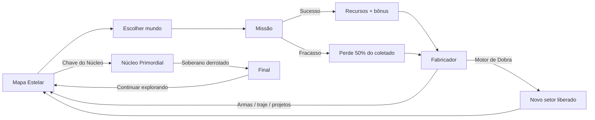
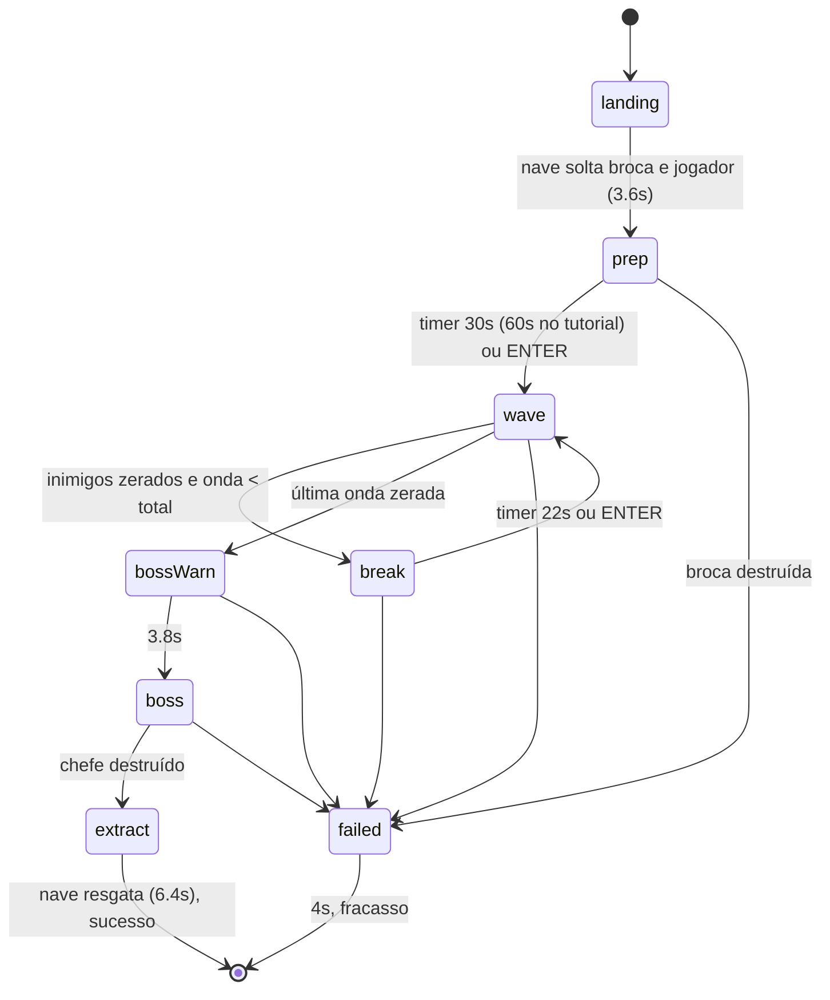
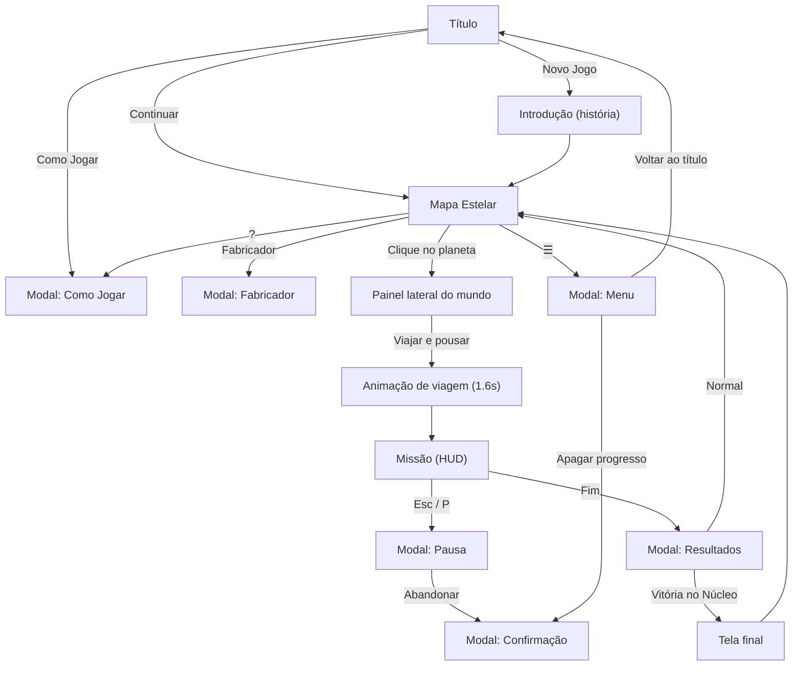

# Explore Worlds — Game Design Document (estado atual da implementação)

> Documento gerado a partir do código-fonte em `js/`. Todos os números (vida, dano, custos, tempos) refletem o que está **implementado hoje**, não intenções de design. A fonte de verdade para balanceamento é [`js/data.js`](../js/data.js); fórmulas de escala ficam em [`js/mission.js`](../js/mission.js).

---

## 1. Visão geral

| Item | Descrição |
|---|---|
| **Gênero** | Tower defense + shooter 2D side-scrolling + exploração/progressão espacial |
| **Plataforma** | Navegador desktop (teclado + mouse), HTML5 Canvas, sem build |
| **Resolução interna** | 480×270 px (pixel art), escalada inteira/meio-inteira para a janela |
| **Idioma** | Português (BR) |
| **Sessão típica** | Missões de ~5–12 min; campanha de 9 mundos |
| **Persistência** | `localStorage` (chave `exploreworlds_save_v1`) |

### 1.1 Premissa

Ano 3127. A humanidade esgotou os recursos do sistema natal. A nave-mãe **AURORA** parte para as bordas do universo. O jogador pousa em mundos hostis, instala a **Broca Extratora** e precisa defendê-la das criaturas nativas. Com os recursos de cada mundo, fabrica armas, construções e motores de dobra para alcançar setores mais distantes, até o **Núcleo Primordial**, origem de toda a fauna hostil, onde enfrenta o **Soberano do Vazio**.

### 1.2 Pilares

1. **Defender o núcleo (a broca)**: o jogador pode morrer e reaparecer; a broca não. Se ela cair, a missão fracassa.
2. **Ação direta + construção**: o jogador atira, esquiva e voa enquanto posiciona e repara defesas em tempo real.
3. **Ambiente como arma**: temperatura e gravidade afetam jogador, armas e inimigos; aquecedores, ar-condicionados e torres de gravidade transformam o clima em vantagem tática.
4. **Loop de extração → fabricação → expansão**: cada mundo dá um recurso-chave necessário para chegar ao próximo setor.

---

## 2. Loop de jogo

### 2.1 Macro loop (campanha)

### 2.2 Micro loop (missão)

Também é possível **abandonar** a missão pelo menu de pausa, o que conta como fracasso.

---

## 3. Fluxo de telas

### 3.1 Título
- Logo "EXPLORE WORLDS", tagline e fundo animado (planeta de lava girando, lua de gelo, nave cruzando a tela com rastro de partículas).
- Botões: **Continuar** (só se houver save), **Novo Jogo** (pede confirmação se já houver save), **Como Jogar**.
- Rodapé avisa que é preciso clicar para liberar o som (política de autoplay) e que **M** silencia.

### 3.2 Introdução
Cinco linhas de texto que aparecem em sequência (≈1.1s cada) contando a premissa, seguidas do botão **Iniciar exploração**.

### 3.3 Mapa Estelar
- **Canvas**: fundo espacial; colunas tracejadas dividindo **Setores 1–4**; rotas entre mundos (tracejado animado quando liberadas); nave-mãe AURORA à esquerda; planetas renderizados proceduralmente e girando; a nave do jogador orbita o último local visitado.
- **Rótulos dos planetas**: nome + `NOVO` (piscando), `BLOQ` (vermelho) ou `OK xN` (vezes concluído).
- **Barra superior (DOM)**: inventário dos 7 recursos e 3 itens; botões ⚙ Fabricador, ? e ☰.
- **Objetivo** contextual, que muda conforme o progresso (ver §9.3).
- **Painel lateral** do mundo selecionado: nome, bioma, setor, descrição, temperatura, gravidade, nº de ondas, chefe, recursos, ameaça (◆◇), avisos de clima/gravidade (que levam em conta o Traje Térmico), aviso de "jazidas parcialmente esgotadas" se já concluído, e o botão **Viajar e pousar** ou o motivo do bloqueio.

### 3.4 Fabricador (modal)
- Inventário completo no topo.
- Abas: **Armas · Traje · Construções · Nave · Itens**.
- Cada card mostra ícone (gerado pelas próprias rotinas de desenho do jogo), nome, descrição, níveis (pips), custo (vermelho se faltar recurso) e botão **Fabricar**; ou "✔ Máximo/Fabricado"; ou o requisito não cumprido.
- Só pode ser acessado no Mapa Estelar (entre missões).

### 3.5 Missão (HUD)

| Região | Conteúdo |
|---|---|
| Superior esquerda | Barra de vida (texto "REIMPLANTANDO Ns" quando morto), combustível do jetpack (se tiver), arma atual + barra de calor (vermelha ao superaquecer), contagem de G/H/F, sucata e ferro |
| Superior centro | Fase atual (POUSANDO, PREPARAÇÃO, ONDA n/N, INTERVALO, ⚠ ALERTA ⚠, CHEFE, EXTRAÇÃO, FRACASSO) + subtítulo (timer, hostis restantes etc.) |
| Abaixo do topo (canvas) | **Minimapa** de 160 px: câmera, zonas térmicas, depósitos, construções, broca, inimigos (terrestres/aéreos), chefe e jogador |
| Barra de chefe | Nome + vida; "· ESCUDO ATIVO" para o Soberano com fragmentos |
| Superior direita | Temperatura local (cor e alerta) e gravidade local (com ALTA/BAIXA se estiver em zona de torre), recursos coletados na missão |
| Inferior centro | Vida da broca (fica vermelha abaixo de 30%), barra de construção com 7 slots (tecla, miniatura, custo, BLOQ), dica contextual |
| Bordas (canvas) | `<N` / `N>` com a quantidade de inimigos fora da tela; `< BROCA` / `BROCA >` quando a broca está fora da tela |
| Overlays | Vinheta permanente; vinheta azul/laranja pulsante quando a temperatura está fora da faixa; vinheta vermelha com vida < 30%; flash de tela |
| Mundo | Prompts flutuantes `[E] EXTRAIR`, `[E] ABRIR CAPSULA`, `[E] GRAVIDADE ALTA/BAIXA`, `[R] REPARAR`; números de dano; textos de coleta |

Também há **banners** centrais (início de onda, fim de onda, alerta de chefe, fases do Soberano), **toasts** (até 4 simultâneos) e o painel **DICA** do tutorial.

### 3.6 Pausa (modal)
Informações (mundo, onda, abates) e os botões **Continuar**, **Controles**, **Som** e **Abandonar missão** (com confirmação e aviso da perda de 50%).

### 3.7 Resultados (modal)
"EXTRAÇÃO CONCLUÍDA" ou "MISSÃO FRACASSADA"; recursos obtidos (inclui bônus), recursos perdidos na evacuação, estatísticas (ondas, abates, construções, depósitos, tempo) e aviso de "Novo mundo conquistado" no primeiro sucesso.

### 3.8 Tela final
Após vencer o Núcleo: texto de epílogo, estatísticas da campanha e o botão **Continuar explorando**, que volta ao mapa (o jogo segue jogável).

### 3.9 Menu (☰)
Liga/desliga o som, volta ao título, apaga o progresso (com confirmação) e mostra estatísticas globais.

---

## 4. Controles

O jogo conta com suporte simultâneo e transparente (*seamless*) entre **Teclado & Mouse** e **Joystick / Gamepad**, com detecção e otimizações dedicadas para o controle **Sony DualSense (PlayStation 5)** e compatíveis via W3C Gamepad API.

### 4.1 Teclado & Mouse

| Tecla | Ação |
|---|---|
| A / D (ou ← →) | Mover |
| W / Espaço / ↑ | Pular; segurar no ar ativa o jetpack |
| S / ↓ | Descer de um Teto (plataforma) |
| Shift | Esquiva (dash) |
| Mouse | Mirar; botão esquerdo atira |
| Q / roda / 1–6 | Trocar de arma |
| B / Tab / botão direito | Entrar/sair do modo construção |
| 1–7 (modo construção) | Escolher construção |
| Clique esq. (construção) | Posicionar |
| Clique dir. (construção) | Desmontar a construção sob o cursor (ou sair do modo) |
| E (segurar) | Extrair veio / abrir cápsula |
| E (tocar) | Alternar a Torre de Gravidade |
| R (segurar) | Reparar construção ou broca (gasta sucata) |
| G / H / F | Granada / Kit médico / Kit de reparo |
| Enter | Chamar a próxima onda antes do tempo (dá bônus) |
| Esc / P | Pausa (Esc sai primeiro do modo construção) |
| M | Liga/desliga o som (global) |

### 4.2 Joystick / DualSense (PlayStation 5)

| Botão / Eixo | Ação em Missão | Ação em Menus / Mapa Estelar |
|---|---|---|
| **Analógico Esquerdo** | Movimento horizontal (com deadzone de 18%) | Mover cursor virtual retrô |
| **Analógico Direito** | **Mira Twin-Stick 360°** com retículo dinâmico | Ajuste fino de cursor |
| **✕ (Cross / Botão 0)** | Pular; segurar no ar ativa o Jetpack | Confirmar / Clicar botão sob o cursor |
| **○ (Circle / Botão 1)** | Esquiva (Dash); Desmontar construção em build | Fechar modal / Desmarcar planeta |
| **▢ (Square / Botão 2)** | Interagir (extrair veios, cápsulas, gravidade) | Lançar missão imediatamente |
| **△ (Triangle / Botão 3)** | Próxima arma | Abrir Fabricador de melhorias |
| **L1 (Bumper Esq. / 4)** | Arma anterior; Construção anterior no build | Navegar abas anteriores |
| **R1 (Bumper Dir. / 5)** | Próxima arma; Construção próxima no build | Navegar próximas abas |
| **L2 (Trigger Esq. / 6)** | Reparar com solda (segurar perto de estruturas) | — |
| **R2 (Trigger Dir. / 7)** | Atirar; Posicionar construção no modo build | Clicar / Confirmar |
| **L3 (Click Analógico E)** | Esquiva (Dash) alternativa | — |
| **R3 (Click Analógico D)** | Alternar Modo de Construção | Centralizar cursor |
| **Touchpad / Create (8)** | Alternar Modo de Construção ou Iniciar Onda | — |
| **Options / Start (9)** | Pausar missão / Fechar modais | Pausar / Voltar |
| **D-pad ▲ (Cima / 12)** | Lançar Granada; Chamar onda no intervalo | Selecionar planeta ao norte |
| **D-pad ▼ (Baixo / 13)** | Descer de plataforma de teto suspensa | Selecionar planeta ao sul |
| **D-pad ◀ (Esq. / 14)** | Usar Kit Médico de emergência | Selecionar planeta a oeste |
| **D-pad ▶ (Dir. / 15)** | Usar Kit de Reparo rápido | Selecionar planeta a leste |

### 4.3 Recursos Especiais do DualSense
- **Mira Twin-Stick 360°**: O analógico direito calcula ângulos em tempo real com projeção de mira na distância ideal, exibindo retículo crosshair cibernético na missão.
- **Feedback Háptico (`dual-rumble`)**:
  - Tiros com perfil por arma: disparos secos no Blaster/Rifle, recuo pesado na Shotgun, trepidação contínua no Raio Criogênico, e estrondo no Railgun e Lança-Foguetes.
  - Danos e explosões escalonadas proporcionalmente à distância e gravidade.
  - Solda e extração com micro-vibração háptica de alta frequência.
  - Teletransporte de dobra espacial ao decolar no Mapa Estelar.
- **Cursor Virtual em Menus**: Quando o controle é utilizado, o analógico esquerdo comanda um cursor virtual retro-futurista, simulando cliques reais em botões DOM (`clickElementAtMouse`).
- **Prompts Dinâmicos**: Todos os tutoriais, HUD, banners e indicações de cenário substituem dinamicamente `[E]`, `[R]`, `[B]` pelos glifos do DualSense (`[▢]`, `[L2]`, `[R3]`, `[✕]`, `[○]`, `[△]`) assim que qualquer entrada no joystick é detectada.

---

## 5. O Jogador (Explorador)

### 5.1 Atributos base

| Atributo | Valor | Upgrades |
|---|---|---|
| Vida máxima | 100 | +30 por nível de **Blindagem do Traje** (máx. 3 → 190) |
| Velocidade | 96 px/s (aceleração 900 no chão / 520 no ar) | — |
| Pulo | impulso de 235 px/s | sofre a gravidade do mundo/zona |
| Esquiva | 330 px/s por 0.16s, recarga de 0.85s, 0.2s de invulnerabilidade | — |
| Jetpack | não tem no início | Nv1: 1.3s de combustível; Nv2: ×1.8 (2.34s). Recarrega 1.2/s no chão |
| Invulnerabilidade ao levar dano | 0.45s (não vale para dano térmico) | — |
| Faixa térmica de conforto | −10°C a +40°C | ±20°C por nível de **Traje Térmico** (máx. 2 → −50 a +80) |
| Raio de coleta | 36 px | 70 px com **Ímã de Coleta** |
| Regeneração | nenhuma | **Nanorreparo**: 2 HP/s após 4s sem levar dano |
| Multiplicador de dano | ×1.0 | +20% por nível de **Calibragem de Dano** (máx. ×1.6) |
| Resfriamento das armas | ×1.0 | +35% por nível de **Dissipador Térmico** (máx. ×1.7) |

### 5.2 Morte e reaparecimento
- Ao morrer: explosão, banner "VOCÊ CAIU" e reimplantação em **5s**, acima da broca, com 2s de invulnerabilidade e o combustível cheio.
- **A morte do jogador não fracassa a missão.** Enquanto ele está morto, a câmera foca a broca e os drones de escolta voltam para ela.

### 5.3 Temperatura
- Fora da faixa de conforto o jogador perde `0.5 + excesso × 0.03` HP a cada 0.5s, aparece uma vinheta colorida e um aviso ("Frio extremo!" / "Calor extremo!").
- A temperatura local é a do mundo somada ao `delta` de cada Aquecedor/Ar-condicionado em cujo raio o jogador está (os efeitos se acumulam).

### 5.4 Calor das armas
- Cada tiro soma `heat` à arma; aos 100 ela **superaquece** e só volta a atirar quando o calor cair abaixo de 35.
- Resfriamento: `38 × fatorTemp × coolMul` por segundo, com ×1.6 para armas guardadas.
- `fatorTemp = clamp(1 + (20 − T)/110, 0.45, 1.9)`: **armas esfriam mais rápido no frio e mais devagar no calor**.

---

## 6. Armas

O jogador começa com o **Blaster**; as demais são fabricadas. Dano base, antes de multiplicadores.

| Arma | Cadência (tiros/s) | Dano/projétil | Projéteis | DPS base | Calor/tiro | Especial | Custo (Fabricador) |
|---|---|---|---|---|---|---|---|
| **Blaster** | 5 | 8 | 1 | 40 | 7 | Confiável, sem superaquecer em clima ameno | Inicial |
| **Espalhadora** | 1.6 | 7 | 7 | ~78 | 24 | Curto alcance (0.38s de vida), empurrão forte (90), recuo no jogador | 35 ferro, 30 sucata |
| **Rifle de Pulso** | 11 | 5.5 | 1 | 60.5 | 4.2 | Cadência altíssima | 50 ferro, 25 biogel |
| **Canhão Criogênico** | 14 | 2.6 | 1 | 36.4 | 3.2 | Atravessa 2 alvos, **congela** (lentidão de ×0.45 por 1.2s), alcance curto | 45 ferro, 30 criocristal |
| **Lança-Foguetes** | 1.3 | 42 | 1 | 54.6 | 30 | Dano em área (raio 38) | 60 ferro, 30 pirita |
| **Railgun Gravitacional** | 0.95 | 75 | instantâneo | 71 | 42 | Hitscan de 560 px que atravessa **todos** os inimigos, empurrão 120, tremor de tela | 80 ferro, 35 gravitônio, 15 criocristal |

Itens de arremesso:
- **Granada [G]**: 70 × multiplicador de dano, área de 46, quica no chão, explode em 1.4s ou ao tocar um inimigo. **Fere o jogador** (35% do dano).

---

## 7. Construções

Posicionadas em grade de 8 px, a mais de 40 px das bordas do mapa, sem sobrepor outras construções, a broca ou depósitos ativos. Todas sobem do chão com animação. **Desmontar** devolve 50% do custo × fração de vida restante.

| # | Construção | Custo | Vida | Disponível | Função |
|---|---|---|---|---|---|
| 1 | **Parede** | 8 sucata, 4 ferro | 260 | Inicial | Sólida: barra inimigos terrestres e o Titã |
| 2 | **Torre de Vigilância** | 22 sucata, 10 ferro | 110 | Inicial | Alcance 150, 3 tiros/s, 6 de dano; mira terrestres, aéreos e o chefe |
| 3 | **Explosivo** | 12 sucata, 4 ferro | 40 | Inicial | Arma em 1s; detona quando um inimigo passa a até 16 px (pavio de 0.35s): 110 de dano, raio 50. **Reação em cadeia** com outras minas. Fere o jogador (45%). Também é detonado por chefes que passam rente ao chão |
| 4 | **Teto** | 16 sucata, 8 ferro | 240 | Projeto | Campo de energia de 48 px de largura que bloqueia voadores, bombas e projéteis inimigos vindos de cima (recebe 60% do dano). A cobertura serve de **plataforma** |
| 5 | **Aquecedor** | 18 sucata, 8 ferro | 100 | Projeto | +70°C num raio de 58 px |
| 6 | **Ar-condicionado** | 18 sucata, 8 ferro | 100 | Projeto | −70°C num raio de 58 px |
| 7 | **Torre de Gravidade** | 28 sucata, 12 ferro | 130 | Projeto | Raio 70. **[E]** alterna: **ALTA** (gravidade ×2.6, inimigos ×0.45 de velocidade, voadores puxados ao chão) / **BAIXA** (gravidade ×0.3, terrestres perdem tração (×0.4) e ficam quicando) |

**Upgrades de construção** (Fabricador › Construções):
- **Torres Mk II/III**: +35% de dano e +15% de alcance por nível (a cor da torre muda).
- **Paredes Reforçadas**: +50% de vida para Paredes e Tetos por nível.
- **Explosivo de Plasma**: ×1.4 no raio e no dano.
- **Termorreguladores Mk II**: Aquecedor/Ar-condicionado com delta ×1.4 (±98°C) e raio ×1.25.

**Reparo [R]**: 70 HP/s na construção danificada mais próxima (até 34 px), ou na broca (até 36 px); custa 1 sucata a cada 10 HP.

---

## 8. A Broca Extratora

- Solta pela nave no pouso; fica no centro do mapa (x = 850 de 1700).
- **Vida**: 1000 × (1 + 0.4 × nível de Blindagem da Broca), até 1800.
- **Extração automática** durante as fases ativas (preparação, ondas, intervalos, chefe):

| Recurso | Taxa base (unid./s) |
|---|---|
| Recurso primário do mundo | 0.34 |
| Recurso secundário (se houver) | 0.14 |
| Ferro (se o primário não for ferro) | 0.20 |

  Multiplicadores: ×(1 + 0.35 × Broca Aprimorada) × (1 + 0.25 × Compartimento de Carga) × 0.6 se o mundo já tiver sido concluído.
- A broca não toma dano durante o pouso, a extração ou depois do fracasso.
- Abaixo de 50% solta fumaça; abaixo de 25%, faíscas; o painel muda de verde para amarelo e vermelho.
- Ao levar dano: toast "A BROCA ESTÁ SOB ATAQUE!" (no máximo a cada 6s).

---

## 9. Mundos e progressão

### 9.1 Biomas

| Bioma | Clima visual | Decoração | Paleta de inimigos |
|---|---|---|---|
| Rochoso | poeira | rochas, pilares | marrom/âmbar |
| Selva | esporos | plantas | verde/rosa |
| Congelado | neve | cristais | azul/ciano |
| Vulcânico | brasas | rochas de lava | vermelho/laranja |
| Anomalia | partículas flutuantes | ilhas flutuantes | roxo/turquesa |
| Vazio | partículas do vazio | agulhas | roxo escuro/magenta |
| Primordial | brasas | agulhas | carmim/dourado |

Cada bioma também tem escala musical e tônica próprias (música generativa).

### 9.2 Mundos

| Mundo | Setor (tier) | Bioma | Temp. | Grav. | Recursos | Ondas | Chefe |
|---|---|---|---|---|---|---|---|
| **Terra Nova** | 1 | Rochoso | +18°C | 1.0 | Ferro | 4 | Verme Colossal |
| **Viridia** | 1 | Selva | +34°C | 0.9 | Biogel | 4 | Rainha da Colmeia |
| **Glacius** | 2 | Congelado | −55°C | 1.0 | Criocristal | 5 | Verme Colossal |
| **Pyros** | 2 | Vulcânico | +95°C | 1.25 | Pirita Ígnea | 5 | Titã Ancestral |
| **Hélion Delta** | 3 | Anomalia | +5°C | 0.5 | Gravitônio | 6 | Rainha da Colmeia |
| **Krios Profundo** | 3 | Congelado | −85°C | 1.5 | Criocristal + Gravitônio | 6 | Titã Ancestral |
| **Fornalha** | 3 | Vulcânico | +125°C | 0.85 | Pirita + Gravitônio | 6 | Verme Colossal |
| **Abismo de Nyx** | 4 | Vazio | −25°C | 0.7 | Essência do Vazio | 7 | Rainha da Colmeia |
| **Núcleo Primordial** | 5 (final) | Primordial | +45°C | 1.0 | Essência do Vazio | 7 | Soberano do Vazio |

**Rotas do mapa**: AURORA → Terra Nova/Viridia → Glacius/Pyros → Hélion → Krios/Fornalha → Nyx → Núcleo. As rotas são só visuais: o acesso depende apenas do Motor de Dobra.

### 9.3 Requisitos de acesso e objetivo exibido

| Progresso | Libera | Objetivo exibido no mapa |
|---|---|---|
| Início | Setor 1 | "Pouse em Terra Nova ou Viridia…" |
| Motor de Dobra Mk II (70 ferro, 30 biogel) | Setor 2 | "Fabrique o Motor de Dobra Mk II…" |
| Motor de Dobra Mk III (110 ferro, 40 crio, 40 piro) | Setor 3 | "Colete Criocristal e Pirita no Setor 2…" |
| Motor de Dobra Mk IV (150 ferro, 55 grav) | Setor 4 | "Explore o Setor 3 em busca de Gravitônio…" |
| Chave do Núcleo (100 ferro, 60 vazio, 30 grav; exige o Mk IV) | Núcleo | "Extraia Essência do Vazio em Nyx…" |
| — | — | "Viaje ao Núcleo Primordial e derrote o Soberano do Vazio!" |
| Vitória | — | "Você conquistou o universo!…" |

O caminho crítico obriga a passar por Viridia (biogel), por Glacius e Pyros (crio e piro), por um mundo do Setor 3 (grav) e por Nyx (vazio).

### 9.4 Escala de dificuldade por tier

| Tier | Vida dos inimigos (`hpMul`) | Dano dos inimigos (`dmgMul`) | Vida do chefe | Bônus de loot |
|---|---|---|---|---|
| 1 | ×1.00 | ×1.00 | ×1.00 | ×1.00 |
| 2 | ×1.45 | ×1.22 | ×1.45 | ×1.15 |
| 3 | ×1.90 | ×1.44 | ×1.90 | ×1.30 |
| 4 | ×2.35 | ×1.66 | ×2.35 | ×1.45 |
| 5 | ×2.80 | ×1.88 | ×2.80 | ×1.60 |

Além disso, cada onda soma **+7% de vida** aos inimigos: `1 + 0.07 × (onda − 1)`.

### 9.5 Mundos repetidos ("esgotados")
Ao repetir um mundo já concluído: depósitos com ×0.6, broca com ×0.6, loot do chefe com ×0.5 e bônus de conclusão com ×0.5. A seed do mapa muda a cada missão (`hash(id) + missões × 7919`).

---

## 10. Inimigos

### 10.1 Fauna comum

| Inimigo | Vida | Vel. | Dano | Ataques/s | Tipo | Sucata | Custo na onda | A partir do nível* |
|---|---|---|---|---|---|---|---|---|
| **Rastejante** | 22 | 42 | 8 | 1.1 | Terrestre corpo a corpo | 2 | 1 | 0 |
| **Cuspidor** | 30 | 30 | 10 | 0.5 | Terrestre à distância (alcance 115): ácido em arco balístico | 4 | 2 | 1 |
| **Vespa** | 16 | 62 | 7 | 0.8 | Aérea: patrulha em altitude e dá rasantes no jogador (se estiver a < 110 px) ou na broca | 3 | 1.5 | 1 |
| **Brutamonte** | 120 | 24 | 22 | 0.8 | Terrestre pesado: dano ×2 em construções, recebe só 25% do empurrão | 7 | 4 | 2 |
| **Bombardeiro** | 60 | 28 | 18 | 0.45 | Aéreo baixo: solta bombas (área 22) sobre a broca, o jogador ou construções sólidas | 6 | 4 | 3 |

\* "Nível" da onda = `onda + (tier − 1) × 2`. Um tipo aparece se `minWave ≤ nível − 1`. No tier 1, a onda 1 só tem Rastejantes, a 2 adiciona Cuspidor e Vespa, a 3 o Brutamonte e a 4 o Bombardeiro. Do tier 3 em diante, todos aparecem desde a onda 1.

**Comportamentos:**
- **Terrestres** andam até a broca e atacam o primeiro obstáculo sólido no caminho (parede, torre, termorregulador, torre de gravidade ou a própria broca). Se o jogador estiver encostado, atacam o jogador.
- **Cuspidor** para e atira no alvo mais próximo à frente (jogador, construção sólida ou broca) quando há algum dentro do alcance.
- **Vespa** fica presa abaixo do campo de um Teto e ataca o teto. Depois de um rasante, recua.
- **Bombardeiro** sob um Teto fica despejando bombas nele.
- A velocidade de cada inimigo varia aleatoriamente entre ×0.9 e ×1.12.

### 10.2 Modificadores ambientais sobre inimigos

Cada inimigo tem como "temperatura nativa" a temperatura do mundo. Diferença entre a temperatura local e a nativa:

| Diferença | Lentidão | Dano contínuo |
|---|---|---|
| > 45°C | ×0.62 | 3.5 HP/s |
| > 90°C | ×0.40 | 9 HP/s |

Outros efeitos: gravidade ALTA (×0.45 e voadores **puxados ao chão**, onde passam a se comportar como terrestres); gravidade BAIXA (terrestres ×0.4 e quicando); congelamento do Canhão Criogênico (×0.45 por 1.2s). Os modificadores se multiplicam.

> **Implicação de design**: em Pyros (+95°C), um Ar-condicionado Mk II (−98°C) cria uma "zona de morte" com o efeito máximo; em Glacius (−55°C), um Aquecedor (+70°C) já gera o efeito intermediário.

### 10.3 Geração de ondas

- **Orçamento**: `5 + 4.5 × onda + 7 × (tier − 1)` pontos, gastos sorteando tipos com pesos por bioma:

| Bioma | Rastejante | Cuspidor | Vespa | Brutamonte | Bombardeiro |
|---|---|---|---|---|---|
| Rochoso | 4 | 2 | 2 | 1.3 | 0.8 |
| Selva | 3 | 1.5 | **4.5** | 1 | 1 |
| Congelado | **4.5** | 2 | 1.5 | 1.6 | 0.7 |
| Vulcânico | 3 | 2.5 | 1.5 | **2.2** | 1 |
| Anomalia | 3 | 2 | 3 | 1 | **2** |
| Vazio | 3 | 2.5 | 3 | 1.8 | 1.8 |
| Primordial | 3 | 2.5 | 3 | 2 | 2 |

- **Lados**: a onda 1 vem sempre de um lado só; nas demais, 25% esquerda, 25% direita e 50% os dois lados. O banner anuncia a quantidade e o(s) lado(s).
- **Intervalo entre spawns**: `clamp(1.5 − 0.12 × onda − 0.1 × (tier − 1), 0.4, 1.5)` s (com variação de ×0.6 a ×1.3), mais uma pausa extra de 2.5× a cada 5 inimigos (grupos).
- **Antecipação**: apertar ENTER com mais de 2s restantes dá `floor(segundos restantes × 0.6)` de sucata.

### 10.4 Chefes

Todos compartilham: barra de vida no HUD, **enfurecimento abaixo de 50%** (exceto o Soberano, que tem fases), lentidão por temperatura (×0.75 / ×0.55) e **+25% de dano recebido** quando fora do clima nativo, lentidão por gravidade alta e por congelamento, dano de contato com recarga por alvo, e uma sequência de morte de 2.2s com explosões que **mata todos os inimigos restantes**. Entram pelo lado anunciado no alerta.

#### Verme Colossal (950 HP base): Terra Nova, Glacius, Fornalha
- Corpo de 18 segmentos que seguem a cabeça (trilha de posições).
- **Subterrâneo**: persegue um alvo (40% jogador, 30% broca, 30% construção aleatória) levantando terra.
- **Tremor**: 0.75s de aviso com "!" e monte de terra pulsante.
- **Salto**: emerge e faz um arco de 100–150 px (dano de contato 22 no jogador, 90 em construções, 45 na broca).
- **A cada 3º ataque, ergue-se** por 4.5s cuspindo 3 bolas de ácido em leque (14 de dano, área 14) a cada 0.9s (0.6s enfurecido); o corpo vertical também causa dano.
- Só é atingível quando está acima do solo.

#### Rainha da Colmeia (850 HP base): Viridia, Hélion Delta, Nyx
- Voa e patrulha entre a broca e o jogador.
- **Esporos**: leque de 7 projéteis (9 enfurecida), 9 de dano, a cada 2.8s (1.8s).
- **Invocação**: 3 Vespas (4 enfurecida) a cada 8s (6s), com limite de 14 inimigos em campo.
- **Investida**: aviso de 0.7s (olhos vermelhos, tremor) e depois mergulho a 280 px/s na posição do jogador (24 de dano), a cada 8s (5s).
- Danifica Tetos ao atravessá-los (35). A gravidade alta a faz voar mais baixo.

#### Titã Ancestral (1250 HP base): Pyros, Krios Profundo
- Colosso que caminha a 13 px/s (×1.35 enfurecido) em direção à broca e para diante de obstáculos.
- **Golpe**: 80 em construções ou 45 na broca a cada 1.6s.
- **Pisão**: a cada 6s (4s); "!" e perna levantada por 0.7s, depois **ondas de choque** correndo pelo chão para os dois lados (20 de dano, 1.5× em construções). Enfurecido, invoca 2 Rastejantes.
- **Bolas de fogo**: 3 em arco (16 de dano, área 20) a cada 3.8s (2.6s).
- **Laser** (só enfurecido, a cada 9s): 1s de mira tracejada e depois varredura no chão por ~2.2s (40 DPS).

#### Soberano do Vazio (3600 HP base → 10.080 no tier 5): Núcleo Primordial
- Núcleo cristalino flutuante com um olho que segue o jogador.
- **Escudo de fragmentos**: 6 fragmentos orbitando (154 HP cada no tier 5) que atiram no jogador. Com qualquer fragmento vivo, o núcleo recebe só **35%** do dano.
- **Fases** por vida: Fase 1 (>66%), Fase 2 (>33%), Fase 3. Cada troca tem banner e flash; ao entrar na Fase 3, **4 fragmentos novos** surgem.
- **Anel de orbes**: 12 projéteis radiais (16 na F3), 11 de dano, a cada 4.8s / 3.6s / 2.2s.
- **Portais** (F2+): a cada 9s/7s abre um portal a 170–260 px da broca que solta 3 inimigos (F3 inclui Brutamontes), com limite de 16 em campo.
- **Laser varredor** (F2+): a cada 8s/6s.
- **Orbes teleguiados** (F3): perseguem o jogador.
- Torres e drones miram primeiro nos fragmentos.

---

## 11. Exploração do mapa

- **Mapa** de 1700 px de largura; a broca fica no centro; a câmera segue o jogador com um deslocamento de 28% na direção do mouse.
- **Depósitos**: 4–5 por missão, a mais de 180 px da broca e a pelo menos 120 px uns dos outros.
  - **Cápsula antiga** (sempre 1): segurar E por 2.6s. Dá 18 × escala do recurso primário + 20 de sucata + (50%) 2 granadas ou (50%) 1 kit médico.
  - **Veio de minério**: segurar E por 1.8s. Dá 10–18 × escala de um recurso (55% primário, senão o secundário ou ferro).
  - Escala: `(1 + 0.15 × (tier − 1))`, × 0.6 se o mundo estiver esgotado.
- **Coleta**: os recursos caem como pickups com física; são atraídos ao entrar no raio de coleta. Ao fim de uma onda, no alerta do chefe e na extração, **todos** os pickups são atraídos automaticamente.

---

## 12. Economia

### 12.1 Recursos

| Recurso | Cor | Origem principal |
|---|---|---|
| Sucata | dourado | Inimigos abatidos, cápsulas, chefes, bônus de antecipação |
| Ferro | prata | Broca em todo mundo, Terra Nova, bônus de conclusão |
| Biogel | verde | Viridia |
| Criocristal | ciano | Glacius, Krios |
| Pirita Ígnea | laranja | Pyros, Fornalha |
| Gravitônio | roxo | Hélion, Krios, Fornalha |
| Essência do Vazio | magenta | Nyx, Núcleo |

**Save inicial**: 60 de sucata, 50 de ferro, 3 granadas, 1 kit médico, Blaster, projetos de Parede/Torre/Explosivo.

### 12.2 Fontes de recurso numa missão
- **Abate**: `round(sucata_do_inimigo × (1 + 0.15 × (tier − 1)))` de sucata, mais 12% de chance de 1–2 do recurso primário.
- **Broca**: fluxo contínuo (§8).
- **Depósitos**: §11.
- **Chefe**: `(25 + 10 × tier)` do primário (×0.5 se esgotado) + 40 de sucata + `(10 + 4 × tier)` do secundário (se houver).
- **Bônus de conclusão** (só no sucesso): `round((30 + 12 × tier) × mul)` do primário + `round(15 × mul)` de ferro, onde `mul = (1 + 0.25 × Carga) × (0.5 se esgotado)`.

### 12.3 Gastos
- Construções e reparos (dentro da missão).
- Receitas do Fabricador (entre missões).
- **Fracasso/abandono**: perde 50% de cada recurso **coletado na missão** (limitado ao que há no inventário). Itens ganhos em cápsulas não são perdidos.

### 12.4 Receitas do Fabricador

**Armas**

| Receita | Níveis | Custos | Efeito |
|---|---|---|---|
| Espalhadora | 1 | 35 ferro, 30 sucata | Libera a arma |
| Rifle de Pulso | 1 | 50 ferro, 25 bio | Libera a arma |
| Canhão Criogênico | 1 | 45 ferro, 30 crio | Libera a arma |
| Lança-Foguetes | 1 | 60 ferro, 30 piro | Libera a arma |
| Railgun Gravitacional | 1 | 80 ferro, 35 grav, 15 crio | Libera a arma |
| Calibragem de Dano | 3 | 30 ferro, 40 sucata → 60 ferro, 20 bio, 15 piro → 90 ferro, 25 grav, 10 vazio | +20% de dano/nível |
| Dissipador Térmico | 2 | 40 ferro, 15 crio → 70 ferro, 35 crio, 10 grav | +35% de resfriamento/nível |
| Munição Perfurante | 3 | 35 ferro, 35 sucata → 55 ferro, 20 crio → 80 ferro, 20 grav, 8 vazio | +10% de chance de crítico (×2,5)/nível |
| Gatilho Acelerado | 3 | 40 ferro, 30 sucata → 60 ferro, 25 bio → 90 ferro, 30 piro, 15 grav | +12% de cadência/nível |
| Granadas de Fragmentação | 1 | 40 ferro, 20 piro | Granadas +60% de dano, raio 46 → 60, soltam 10 estilhaços |
| Sifão Vital | 2 | 35 bio, 30 sucata → 60 bio, 12 vazio | +1 HP por abate/nível |

**Traje**

| Receita | Níveis | Custos | Efeito |
|---|---|---|---|
| Blindagem do Traje | 3 | 30 ferro, 25 sucata → 55 ferro, 20 bio → 80 ferro, 25 piro, 25 crio | +30 de vida máx./nível |
| Jetpack | 2 | 35 ferro, 15 bio → 60 ferro, 20 grav | Voo; Nv2 +80% de combustível |
| Traje Térmico | 2 | 30 ferro, 20 bio → 60 ferro, 20 crio, 20 piro | ±20°C de conforto/nível |
| Ímã de Coleta | 1 | 25 ferro, 30 sucata | Raio de coleta 36 → 70 |
| Nanorreparo | 1 | 40 bio, 15 grav | Regenera 2 HP/s fora de combate |
| Servomotores | 2 | 30 ferro, 25 sucata → 50 ferro, 15 grav | +12% de velocidade/nível |
| Propulsor de Esquiva | 2 | 30 ferro, 15 bio → 55 ferro, 20 piro | Recarga da esquiva −30%/nível; Nv2 a esquiva causa 25 de dano |
| Escudo de Energia | 2 | 50 ferro, 20 crio → 80 ferro, 25 grav, 8 vazio | Escudo de 25/50 pontos; recarrega 12/s após 3s sem dano |
| Botas Gravitacionais | 1 | 40 ferro, 15 grav | Pulo duplo |
| Kit de Garimpo | 2 | 25 ferro, 40 sucata → 45 ferro, 25 bio | +25% de sucata dos inimigos/nível |

**Construções**

| Receita | Níveis | Custos | Efeito |
|---|---|---|---|
| Projeto: Teto | 1 | 35 ferro, 20 sucata | Libera o Teto |
| Projeto: Aquecedor | 1 | 40 ferro, 15 bio | Libera o Aquecedor |
| Projeto: Ar-condicionado | 1 | 40 ferro, 15 bio | Libera o Ar-condicionado |
| Projeto: Torre de Gravidade | 1 | 60 ferro, 20 crio, 20 piro | Libera a Torre de Gravidade |
| Torres Mk II/III | 2 | 50 ferro, 40 sucata → 80 ferro, 25 piro, 25 crio | +35% de dano, +15% de alcance |
| Paredes Reforçadas | 2 | 40 ferro, 30 sucata → 60 ferro, 20 grav | +50% de vida em paredes/tetos |
| Explosivo de Plasma | 1 | 40 ferro, 25 piro | +40% de raio/dano |
| Termorreguladores Mk II | 1 | 30 ferro, 25 crio, 25 piro | +40% de força, +25% de raio |
| Fabricação Modular | 2 | 50 ferro, 40 sucata → 80 ferro, 20 crio, 20 piro | Construções custam −15%/nível |
| Nanorrobôs de Reparo | 2 | 45 ferro, 25 bio → 70 ferro, 40 bio, 15 grav | Construções regeneram 1% da vida/s por nível |
| Sincronizador de Torres | 2 | 45 ferro, 15 crio → 70 ferro, 25 piro | +25% de cadência das torres/nível |
| Reciclagem | 1 | 30 ferro, 30 sucata | Desmontar devolve 80% (em vez de 50%) |
| Ressonador Gravitacional | 1 | 50 ferro, 35 grav | Torre de Gravidade +30% de raio; modo ALTO causa 6 de dano/s |

**Nave**

| Receita | Níveis | Custos | Efeito |
|---|---|---|---|
| Motor de Dobra | 3 (Mk II–IV) | 70 ferro, 30 bio → 110 ferro, 40 crio, 40 piro → 150 ferro, 55 grav | Libera os setores 2, 3 e 4 |
| Chave do Núcleo | 1 | 100 ferro, 60 vazio, 30 grav (exige Mk IV) | Libera o Núcleo Primordial |
| Broca Aprimorada | 3 | 40 ferro, 30 sucata → 70 ferro, 20 piro → 100 ferro, 25 grav | +35% de extração/nível |
| Blindagem da Broca | 2 | 50 ferro, 30 sucata → 90 ferro, 25 crio | +40% de vida da broca/nível |
| Compartimento de Carga | 2 | 45 ferro, 15 bio → 80 ferro, 20 piro, 20 crio | +25% de extração e de bônus de conclusão |
| Drone de Escolta | 2 | 60 ferro, 25 bio, 40 sucata → 90 ferro, 25 grav | 1 ou 2 drones que seguem o jogador (5 de dano, 2.5 tiros/s, alcance 160) |
| Torreta da Broca | 2 | 60 ferro, 40 sucata → 90 ferro, 25 piro | 1 ou 2 canhões na broca (9 de dano, 2.2 tiros/s, alcance 170) |
| Reator de Reparo | 2 | 50 ferro, 30 bio → 80 ferro, 25 crio, 15 grav | A broca regenera 3 HP/s por nível durante a missão |
| Scanner Orbital | 1 | 40 ferro, 20 crio | +2 depósitos por missão, veios +30% mais ricos |
| Satélite de Ataque | 2 | 80 ferro, 30 grav → 110 ferro, 25 vazio | Raio orbital automático no maior grupo de inimigos (raio 42): 120 de dano a cada 20s; Nv2 190 a cada 12s |
| Logística de Pouso | 2 | 30 ferro, 30 sucata → 50 ferro, 20 bio | +40 sucata no início da missão e +15s de preparação/nível |

**Itens (consumíveis, repetíveis)**

| Item | Custo | Efeito |
|---|---|---|
| Granadas ×3 [G] | 15 sucata, 6 ferro | Explosivo arremessável |
| Kit Médico [H] | 10 bio, 8 sucata | +60 de vida |
| Kit de Reparo [F] | 20 ferro, 10 sucata | Repara 40% de todas as construções e 15% da broca |

---

## 13. Tutorial

Ativo na primeira missão (`tutorialDone = false`). A preparação dura **60s** em vez de 30s e as dicas aparecem em sequência:

1. Mover (A/D), pular (W/Espaço) e esquivar (Shift). Avança ao se mover ou após 7s.
2. Mirar e atirar com o mouse; Q/roda troca de arma. Avança ao atirar ou após 9s.
3. **B** abre o modo construção, 1–7 escolhe; proteja a broca. Avança ao construir ou após 16s.
4. **E** extrai veios; **R** repara. Avança após 10s.
5. **ENTER** chama a primeira onda.

O tutorial termina quando a primeira onda começa, e a flag é salva ao fim da missão (com sucesso ou não).

---

## 14. Áudio e feedback

- **SFX 100% sintetizados** (WebAudio): cada arma, acerto, morte, explosão (normal/grande), dano, coleta, construção, venda, erro, clique, fabricação, início de onda, alarme, vitória, derrota, pulo, esquiva, superaquecimento, dobra, pisão, rugido, laser, mina, reparo, alternância e broca. Há um anti-spam por som (intervalo mínimo).
- **Música generativa**: um pad de acorde (serra com filtro e LFO) e notas sorteadas na escala pentatônica/modal do bioma. O modo **calmo** toca no mapa, na preparação e nos intervalos; o modo **combate** (bumbo, chimbal, baixo) toca nas ondas. A intensidade sobe a cada onda e chega ao máximo no chefe.
- **Game feel**: tremor de tela proporcional ao impacto, flash de tela, partículas (faíscas, fumaça, detritos que quicam), números de dano (dourados ≥ 40), flash branco nos sprites atingidos, recuo da arma, cor da arma esquentando, avisos "!" antes dos ataques de chefe, mira tracejada antes dos lasers.

---

## 15. Direção de arte

- Pixel art em 480×270 e **todos os sprites gerados em código** (matrizes de caracteres + paletas). Os inimigos trocam de paleta conforme o bioma.
- Planetas renderizados proceduralmente (ruído + iluminação), com quadros de rotação em cache.
- Cenário: céu em faixas com dithering, estrelas, nebulosas, astro do bioma (lua/sol/planeta/anéis/fenda), 3 camadas de montanhas em parallax (0.12/0.28/0.5), terreno com estratos e decorações do bioma, partículas de clima.
- Interface DOM com as fontes **Press Start 2P** e **VT323** (Google Fonts) e texto bitmap 3×5 próprio dentro do canvas.

---

## 16. Estatísticas persistentes

Missões, sucessos, abates, chefes derrotados (exibidos no Menu e no final), mundos concluídos (com contagem), local atual da nave e a flag de vitória.

---

## 17. Pontos observados para iteração de design

- O progresso da missão só é gravado no `localStorage` ao final; fechar a aba no meio da missão descarta os ganhos e os gastos dela.
- As rotas do mapa estelar são decorativas: qualquer mundo de tier liberado pode ser visitado diretamente.
- Hélion Delta (gravidade 0.5) não tem um recurso secundário que justifique revisitar, ao contrário de Krios e Fornalha.
- `playTime` existe nas estatísticas do save, mas não é incrementado.
- Não há dificuldade selecionável nem um modo infinito após o final (só repetir mundos com rendimento reduzido).
